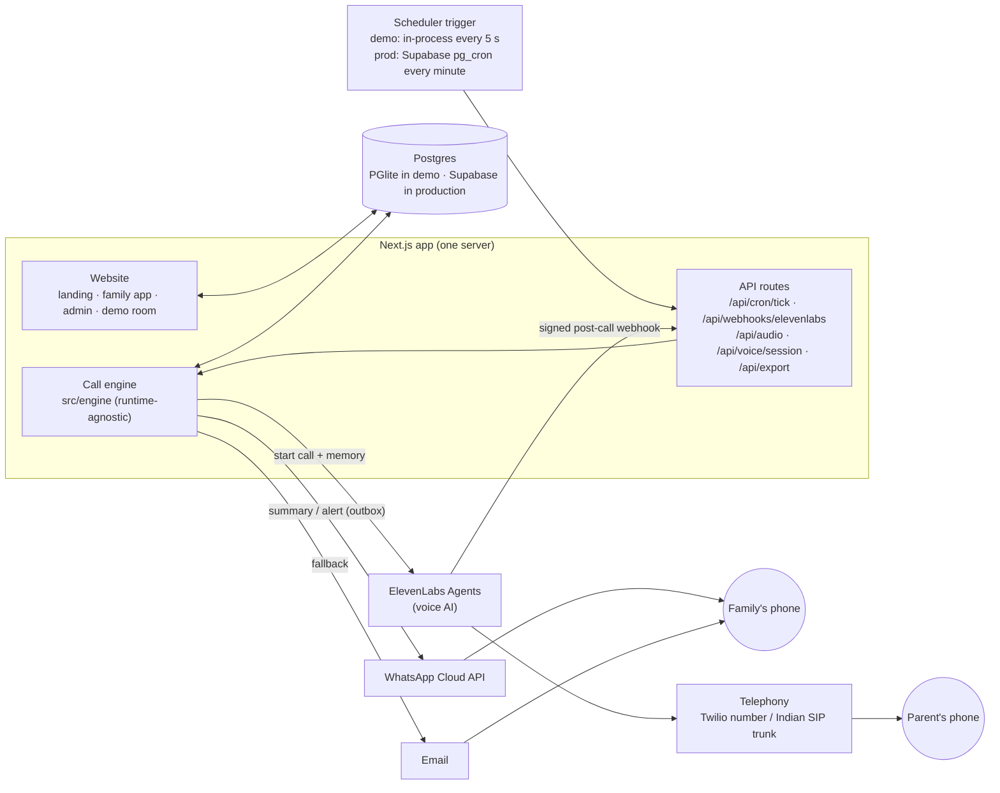
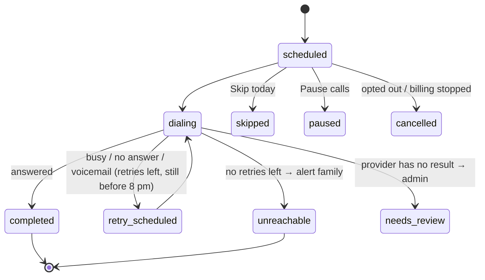

# Architecture

How Khairiyat works, and why it's built this way.

## 1. The big picture

**In simple words:** families set things up on the website. Every minute a "tick" runs the call engine. It decides who is due, dials within the concurrency limit, receives results, writes summaries, raises alerts and sends messages. Everything important is a row in the database first, so nothing is lost if a step fails halfway. The next tick finishes the job.

## 2. Key decisions (and why)

| Decision                                      | Why                                                                                                                                                                                                                                   |
| --------------------------------------------- | ------------------------------------------------------------------------------------------------------------------------------------------------------------------------------------------------------------------------------------- |
| **₹0 fixed cost**, demo-first                 | Founder requirement. Real providers switch on per provider when keys are added.                                                                                                                                                       |
| **Next.js 16 + TypeScript strict + Tailwind** | One codebase for landing, family app, admin and API. Cache Components is off: almost every page is per-family.                                                                                                                        |
| **Engine is runtime-agnostic** (`src/engine`) | No Node-only or Next-only imports, time from an injected `Clock`, providers injected. The same code runs in the app, in tests, in the virtual-week simulation, and later in Supabase Edge Functions if needed.                        |
| **Better Auth** (not Supabase Auth)           | Login runs inside our app, users live in our Postgres. Demo mode needs no Docker; same code in demo, tests and production.                                                                                                            |
| **PGlite in demo**                            | Real Postgres compiled to WebAssembly, inside Node. Zero install. Stored in `~/.khairiyat/demo-data`, outside the project, because the dev server watches the project folder. CI also runs the integration tests on real Postgres 16. |
| **Outbox + inbox tables**                     | Every message is a `notifications` row before sending (retries, backoff, email fallback, dead letters in admin). Every webhook is a `webhook_events` row before processing (deduped).                                                 |
| **Hard rules in the database**                | Code has bugs; constraints don't forget (see §4).                                                                                                                                                                                     |
| **Audio never stored by us**                  | Streamed from ElevenLabs through an authenticated proxy. Less personal data, no storage bill.                                                                                                                                         |
| **Agent as code** (`agent/`)                  | Prompt, greetings, data fields, evaluation criteria and scenarios are versioned; `npm run agent:sync` pushes them. No untracked dashboard edits.                                                                                      |

## 3. Providers and demo mode

`src/lib/env.ts` decides per provider:

- no keys → **mock** (demo)
- all keys → **real**
- some keys → **refuse to start** (a half-configured provider must never silently drop alerts)
- production + mock providers → refuse to start (unless `ALLOW_DEMO_PROVIDERS_IN_PRODUCTION=true`)
- `APP_ENV=demo` (the public demo website) + any real provider, or the browser voice → refuse to start: demo parents have made-up numbers that may belong to real people, and visitors must not spend ElevenLabs credits
- only `ELEVENLABS_API_KEY` + `ELEVENLABS_AGENT_ID` → calls stay simulated, but "Talk to Roshni" in the browser works

| Provider | Interface                                                                 | Real                                                    | Mock                                                                                                                          |
| -------- | ------------------------------------------------------------------------- | ------------------------------------------------------- | ----------------------------------------------------------------------------------------------------------------------------- |
| Voice    | `src/providers/voice/types.ts` (`startCall`, `getStatus`, `parseWebhook`) | `elevenlabs.ts` (Twilio or SIP outbound, HMAC webhooks) | `mock.ts`: emits **ElevenLabs-shaped signed webhooks** from realistic scripts, so demo runs the exact production parsing code |
| WhatsApp | `src/providers/whatsapp/types.ts`                                         | not built yet (go-live step)                            | stores messages for the Demo room phone                                                                                       |
| Email    | `src/providers/email/types.ts`                                            | not built yet (go-live step)                            | stores messages for the Demo room inbox                                                                                       |
| Payments | `src/engine/billing.ts` (state)                                           | not built yet (go-live step)                            | demo checkout page                                                                                                            |

## 4. The call engine

### Hard rules (enforced in the database, not only in code)

| Rule                                             | How                                                                                                                                                                                                |
| ------------------------------------------------ | -------------------------------------------------------------------------------------------------------------------------------------------------------------------------------------------------- |
| Never double-call a parent for the same slot     | `UNIQUE (parent_id, local_date, slot)` on `check_ins`; slots `daily`, `consent`, `manual-1..3`                                                                                                     |
| Never call outside 08:00–20:00 parent-local time | Checked when scheduling, retrying and dialling, **and** a trigger rejects any `call_attempts` insert outside the window (`drizzle/0001_guards.sql`)                                                |
| Never call someone who said stop                 | Opt-out stops calls at once; the same trigger rejects dials to opted-out parents                                                                                                                   |
| Never silently drop an alert                     | Outbox with `UNIQUE (idempotency_key)`, retries with backoff (1, 5, 15, 60, 180 min), email fallback, dead letters visible in Admin → Failures. Urgent alerts go to WhatsApp **and** email at once |
| Every webhook processed once                     | `UNIQUE (provider, event_key)`, key = `conversation_id:event_type`                                                                                                                                 |
| Only call eligible parents                       | Consent given (or this is the consent call), not paused/opted out, billing trial/active/grace/cancelled-but-paid                                                                                   |
| One tick at a time                               | A lease row (`engine_leases`) with expiry; rows claimed with `FOR UPDATE SKIP LOCKED`                                                                                                              |

### The tick (`src/engine/tick.ts`, every minute, safe to run twice)

1. Deliver due mock webhooks (demo only).
2. Auto-resume paused parents. Apply billing changes (trial warning, expiry, grace over, cancellations).
3. **Create** due check-ins (catch-up up to 3 h late; later than that, or after 8 pm, the family gets an honest "our fault" message).
4. Process stored webhooks not yet processed.
5. **Reconcile** calls with no result after 10 min: ask the provider; unknown after 45 min → admin review.
6. **Dial** up to the concurrency limit (default 4 = your ElevenLabs workspace).
7. **Send** due messages. Every 15 min: daily/weekly digests. Nightly: transcript retention purge.

### Check-in states

Updates are conditional (expected status + `version`), so late, duplicate or out-of-order webhooks are harmless.

### After each call (`src/engine/post-call.ts`)

Classify (answered / busy / no answer / voicemail by provider result, carrier phrases, or a very short call with no words) → store transcript, duration, estimated cost → **red flags** = agent flag **plus** a keyword scan of the parent's words in Devanagari, romanised Hindi/Urdu and English (negation-aware) → **distress** (hopelessness) → consent / opt-out → memory (follow-ups, notes used) → summary ≤600 chars (agent's own if usable, else built from fields; EN + HI) → messages.

### Memory (`src/engine/memory.ts`)

Before each call: `first_message` (scripted greeting with AI disclosure), `parent_name`, `address_as`, `assistant_name`, `assistant_gender`, `family_member_name`, `language`, `hearing_difficulty`, `medicines_due_now`, `family_note_for_today`, `last_calls_summary`, `follow_ups`, `topics_enjoyed`, `topics_to_avoid`, `be_gentle_about`, `is_consent_call`, `call_time`, `max_minutes`, plus `secret__*` ids (never sent to the LLM) to match results back. Each value is capped to keep the prompt short.

### Capacity

4 simultaneous calls ≈ 48 calls an hour. Onboarding warns when a 15-minute slot is busy; Admin → Today shows load per half hour. The load test shows a 1,000-parent tick finishes in under 2 s.

## 5. Data model

| Group          | Tables                                                                                                                                |
| -------------- | ------------------------------------------------------------------------------------------------------------------------------------- |
| Auth           | `users`, `sessions`, `accounts`, `verifications`, `rate_limits`                                                                       |
| People         | `families`, `family_members` (role, notification mode, language, channels, time zone), `invitations`                                  |
| Parent setup   | `parents`, `parent_health_notes` (encrypted), `schedules`, `medicines`, `family_notes` (news + next-call notes), `emergency_contacts` |
| Calls          | `check_ins`, `call_attempts`, `call_results`, `follow_ups`, `alerts`                                                                  |
| Infrastructure | `notifications` (outbox), `webhook_events` (inbox), `job_runs`, `engine_leases`                                                       |
| Billing        | `plans`, `add_ons` (e.g. future Lucknow visit), `subscriptions` (one per parent), `subscription_add_ons`, `payments`, `invoices`      |
| Operations     | `app_settings`, `audit_logs`, `problem_reports`                                                                                       |
| Demo only      | `mock_messages`, `mock_calls`, `demo_scenarios`                                                                                       |

## 6. Security and privacy

- **Access:** every page and action goes through `requireMember` / `requireParent` / `requireAdmin` (`src/server/session.ts`). A parent from another family is a 404. RLS is enabled on every table (deny-all for Supabase's public API).
- **Encryption:** health notes with AES-256-GCM (`v1:` versioned). Logs redact phones, emails, transcripts and secrets.
- **Webhooks:** ElevenLabs HMAC (`t=…,v0=…` over `timestamp.rawBody`, 30-minute window; format confirmed in the official SDK). The cron endpoint needs `CRON_SECRET`.
- **Headers:** CSP, frame-ancestors none, nosniff, referrer policy, permissions policy (mic only for our pages), HSTS when served over HTTPS.
- **Abuse limits:** Better Auth rate limits (production) and per-user limits on invites, reports, exports and voice sessions.
- **DPDP Act 2023:** consent call, purpose limitation, export (JSON) and erasure, 180-day transcript retention (per family, 30–730 days), audit log.

## 7. Testing

| Layer                                | What                                                                                                                                                                                                        |
| ------------------------------------ | ----------------------------------------------------------------------------------------------------------------------------------------------------------------------------------------------------------- |
| Unit                                 | env rules, logging redaction, phone/time/DST, crypto, red-flag words, classification, templates, summaries, status card, digest, ElevenLabs request/response/signature                                      |
| Integration (PGlite and Postgres 16) | DB guard rails, engine flows (retries, 8 pm cutoff, voicemail, red flag within a minute, opt-out, consent, lost/duplicate/out-of-order webhooks, email fallback, London DST, kill switch, billing), privacy |
| Simulation                           | `npm run simulate:week`: 50 parents × 7 days with chaos; asserts every hard rule                                                                                                                            |
| Load                                 | `npm run loadtest:tick`: 1,000 parents                                                                                                                                                                      |
| e2e (Playwright, 390px + desktop)    | sign up → onboarding → introduction call → red-flag call → summary + alert → phone preview → payment → export → delete; demo/admin; privacy redirects                                                       |

## 8. The public demo website (`APP_ENV=demo`, Netlify)

The online demo (https://khairiyat-demo.netlify.app) is the same app with every provider mocked, on serverless hosting:

- **Database:** the site's **Netlify Database** (Postgres). Netlify sets `NETLIFY_DB_URL` and applies `netlify/database/migrations/` on each deploy. Those files are exact copies of `drizzle/` (`npm run db:generate` copies new ones; `tests/unit/netlify-migrations.test.ts` checks), and the app does not run its own migrator there.
- **No background scheduler.** A per-minute scheduled function would keep the database awake all day and use up the free plan's credits. Instead `src/server/demo-world.ts` moves the demo forward when someone opens a page (`DemoWorldGate` in the auth, family app, admin and demo layouts):
  - first visit: create the families, then build three weeks of history **in steps of about 8 seconds per page load** (progress screen; Netlify functions stop at 60 s). `continueDemoWorld()` resumes from the last tick, and the scenario plan is stored in `app_settings.demo_world`;
  - a quiet period of 15+ minutes: replay it the same way;
  - otherwise: one normal tick after the response (`after()`), at most every 4 seconds. Pages refresh themselves while a pretend call runs.
  - a `demo-world` lease lets only one request move the world at a time. The database still enforces the hard rules.
- The landing page starts the build in the background, so the demo is usually ready by the time someone clicks "Log in".
- Public-site settings: secure cookies, login rate limits, `robots.txt` disallows everything, and visitors are told not to enter real details.

## 9. Production layout (when going live)

Recommended free-to-start setup: **Supabase** (Postgres in Mumbai) + **Netlify** (website), with **pg_cron** calling `POST /api/cron/tick` every minute (`supabase/sql/cron.sql`). If the website host ever becomes a bottleneck, the runtime-agnostic engine can move into Supabase Edge Functions without changes to its logic. See [GO_LIVE.md](GO_LIVE.md).
