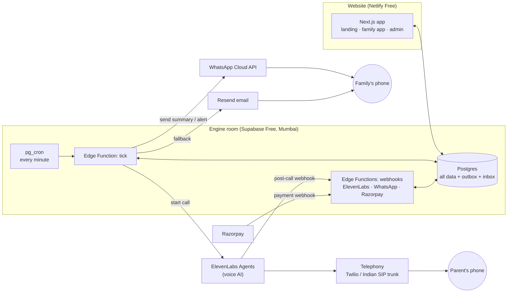
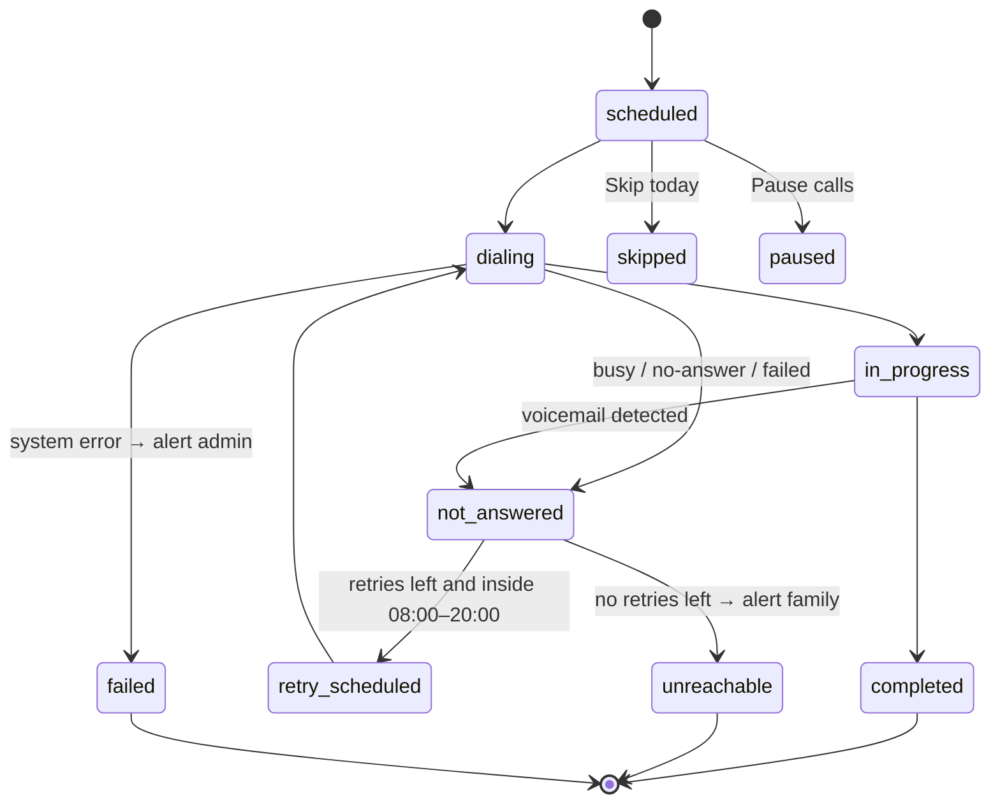

# Architecture

This document explains how Khairiyat works and why it is built this way. Parts marked _(Phase N)_ are designed but not built yet.

## 1. The big picture

**In simple words:** the website is where families set things up and read summaries. The **engine room** runs inside Supabase, right next to the database. It makes the calls, receives the results and sends WhatsApp alerts. If the website goes down, calls and alerts keep working.

## 2. Key decisions (and why)

| Decision                                                 | Why                                                                                                                                                                                                                                            |
| -------------------------------------------------------- | ---------------------------------------------------------------------------------------------------------------------------------------------------------------------------------------------------------------------------------------------- |
| **₹0 fixed cost** stack                                  | Founder requirement. Variable costs (call minutes, WhatsApp messages, payment fees) grow only with paying families.                                                                                                                            |
| Netlify Free instead of Vercel                           | Vercel's free (Hobby) plan is for personal, non-commercial use only. Netlify Free has no such restriction in its pricing terms (re-confirm before first deploy). Its limit: 300 credits a month; if exceeded, **only the website** pauses.     |
| Engine in **Supabase Edge Functions**, ticked by pg_cron | The scheduler lives in the database, so it survives deploys and restarts. It sits next to the data (fast, Mumbai), costs nothing (~45k of 500k free invocations a month) and doesn't depend on website hosting. Each run can take up to 150 s. |
| Engine code is **runtime-agnostic TypeScript**           | The same `src/engine` code runs in Node (demo, tests, simulation) and Deno (Supabase). No Node-only APIs in the engine (Web Crypto, `fetch` only).                                                                                             |
| **Better Auth** instead of Supabase Auth                 | Login runs inside our app and stores users in our Postgres. Demo mode needs no Docker, and the same login code runs in demo, tests and production.                                                                                             |
| **PGlite** for demo mode                                 | Real Postgres compiled to WebAssembly, running inside Node. Demo mode needs nothing installed. CI also tests against real Postgres 16.                                                                                                         |
| **Drizzle ORM + zod**                                    | Typed queries and typed validation at every boundary (forms, webhooks, env).                                                                                                                                                                   |
| **Luxon** for time                                       | Correct time-zone and daylight-saving handling (parents in IST, children in London/New York).                                                                                                                                                  |
| **Outbox / inbox tables**                                | Every notification is a row before it is sent (never silently dropped). Every webhook is a row before it is processed, deduplicated by a unique key.                                                                                           |
| Hard rules enforced **in the database**                  | Code has bugs; constraints don't forget. See §4.                                                                                                                                                                                               |
| Audio **not stored by us**                               | Streamed from ElevenLabs through an authenticated proxy. Saves space (the free 1 GB would fill after ~400 calls) and limits the personal data we hold.                                                                                         |

## 3. Demo mode and providers

`src/lib/env.ts` decides, for each provider, whether to use the **real** implementation or a **mock**:

- no keys → mock (demo)
- all keys → real
- some keys → **refuse to start** (a half-configured provider must never silently drop alerts)
- production + mock providers → refuse to start, unless `ALLOW_DEMO_PROVIDERS_IN_PRODUCTION=true` (public demo site only)

Every external service sits behind an interface with a mock: `VoiceProvider` (`startCall`, `getStatus`, `parseWebhook`), `WhatsAppProvider`, `EmailProvider`, `PaymentsProvider`, `StorageProvider` _(Phases 2–5)_. Adding Bolna or Exotel later means one new file per provider.

## 4. The call engine _(Phase 2)_

### Hard rules (enforced in the database, not only in code)

| Rule                                             | How it is enforced                                                                                                          |
| ------------------------------------------------ | --------------------------------------------------------------------------------------------------------------------------- |
| Never double-call a parent for the same slot     | `UNIQUE (parent_id, local_date, slot)` on `check_ins`. Slots: `consent`, `daily`, `manual-1..n`                             |
| Never call outside 08:00–20:00 parent-local time | Checked when scheduling, retrying and dialling, **and** a DB trigger rejects any `call_attempts` insert outside the window  |
| Never call someone who said stop                 | Opt-out pauses the parent at once. The same trigger rejects dials to opted-out parents                                      |
| Never silently drop an alert                     | `notifications` outbox with `UNIQUE (idempotency_key)`, retries with backoff, email fallback, dead letters visible in admin |
| Every webhook processed exactly once             | `webhook_events` inbox with `UNIQUE (provider, event_key)`, e.g. `conversation_id + event type`                             |
| Only call eligible parents                       | Consent given, not paused or opted out, and billing is trial, active or grace                                               |

### The tick (every minute, safe to run twice)

1. Record a heartbeat and ping Healthchecks.io (alerts the founder if ticks stop).
2. **Create** due check-ins for eligible parents, catching up if earlier ticks were missed.
3. **Dial** due check-ins, up to the concurrency limit (default 4, matching the ElevenLabs workspace). Rows are claimed with `FOR UPDATE SKIP LOCKED`.
4. **Reconcile** attempts with no result after 10 minutes: ask the provider, then process the result or flag it for admin review.
5. **Process** any webhook events not yet processed (in case background processing died).
6. **Send** due notifications from the outbox (WhatsApp first, email fallback).
7. Housekeeping: auto-resume paused parents, retention purge, weekly digests.

A Postgres advisory lock stops two overlapping ticks from both running.

### Check-in states

The state machine is a pure function (`state + event → new state + side effects`) with exhaustive tests. Terminal states never go backwards, so late or out-of-order webhooks are harmless.

### After each call

Store transcript, duration and cost → red-flag detection (the agent's own flag **plus** a server keyword scan in Devanagari, romanized Hindi/Urdu and English) → family summary (≤600 characters, warm, factual, no medical conclusions) → update memory and follow-ups → enqueue notifications. Red-flag alerts go out immediately, on WhatsApp **and** email.

### Capacity

With 4 concurrent calls and ~5 minutes per call, the system can make about 48 calls an hour. The onboarding wizard warns when a time slot is nearly full, and admin shows capacity use. Raising the ElevenLabs plan raises the limit (it's a setting).

## 5. Data model _(Phase 1)_

| Group          | Tables                                                                                                                                                                   |
| -------------- | ------------------------------------------------------------------------------------------------------------------------------------------------------------------------ |
| Auth           | Better Auth tables (users, sessions, accounts, verifications)                                                                                                            |
| People         | `families`, `family_members` (role, notification mode, language, channels), `invitations`                                                                                |
| Parent setup   | `parents`, `parent_health_notes` (encrypted), `schedules`, `medicines`, `personalization`, `family_news`, `next_call_notes`, `emergency_contacts`, `onboarding_progress` |
| Calls          | `check_ins`, `call_attempts`, `call_results`, `follow_ups`, `alerts`                                                                                                     |
| Infrastructure | `notifications` (outbox), `webhook_events` (inbox), `job_runs`                                                                                                           |
| Billing        | `plans`, `add_ons`, `subscriptions` (one per parent), `payments`, `invoices`                                                                                             |
| Operations     | `app_settings` (retry policy, concurrency, cost rates, feature flags), `audit_logs`, `problem_reports`                                                                   |

Plans and prices live in the `plans` table (seeded from `src/config/defaults.ts`) and are editable in admin. Nothing is hard-coded.

## 6. Security and privacy

- **Row Level Security** is on for every table with deny-all for Supabase's public API, so the anon key can read nothing. All access goes through our server code, which checks family membership on every query (`src/server/authz.ts`, tested).
- **Encrypted fields:** health notes and similar sensitive text use AES-256-GCM with a versioned key (`DATA_ENCRYPTION_KEY`).
- **Webhooks:** signatures are verified on the raw body (ElevenLabs HMAC with a 30-minute window, Razorpay `X-Razorpay-Signature`, Meta `X-Hub-Signature-256`).
- **Logs** never contain phone numbers, emails, transcripts or secrets (`src/lib/logger.ts` redacts them).
- Secure headers and CSP, CSRF protection (Better Auth + Next.js server action origin checks), rate limiting, input validation with zod everywhere, and an audit log of admin actions.
- **DPDP Act 2023:** the parent is the data principal, so the first call is a consent call. Data is purpose-limited, exportable and deletable, with retention settings (transcripts 180 days by default).

## 7. Free-tier limits to watch

| Service           | Free limit                                  | Our expected use                     | Upgrade trigger                                   |
| ----------------- | ------------------------------------------- | ------------------------------------ | ------------------------------------------------- |
| Supabase DB       | 500 MB, pauses after 7 days of low activity | tiny (text only), ticks every minute | ~10 paying families → Pro ($25) for daily backups |
| Supabase Edge Fns | 500k invocations a month                    | ~50k                                 | >350k a month                                     |
| Netlify           | 300 credits a month (website only)          | low                                  | >70% used in a month                              |
| Resend            | 3,000 emails a month, 100 a day             | auth + fallback                      | >70 a day                                         |
| GitHub Actions    | 2,000 min a month (private repo)            | CI + nightly backup                  | >1,500 min a month                                |
